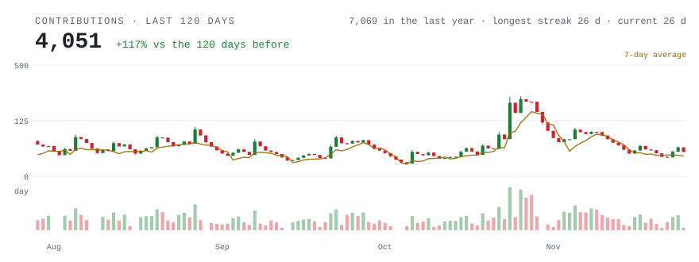

<picture>
  <source media="(max-width: 600px) and (prefers-color-scheme: dark)" srcset="assets/hero-dark-narrow.svg">
  <source media="(max-width: 600px)" srcset="assets/hero-light-narrow.svg">
  <source media="(prefers-color-scheme: dark)" srcset="assets/hero-dark.svg">
  
</picture>

I'm a full-stack software engineer who loves crafting elegant solutions to complex problems, and I'm most at home in frontend and UI/UX. These days I build AI-assisted data platforms end to end: the interface people use, the Python services and pipelines behind it, and AI assistants that only change things once a person approves.

*   🌍  I'm based in Nairobi
*   🚀  I'm currently building AI tooling, workflow engines and the design system the apps run on
*   🎨  I care about the details: design systems, accessible dashboards, dark and light themes, phone-first layouts
*   🖥️  See my portfolio at [TrevorAntony](http://portfolio-psi-liart-96.vercel.app/)
*   ✉️  You can contact me at [trvromondi@gmail.com](mailto:trvromondi@gmail.com)
    <!-- open-source:start -->
*   🧩  15 merged pull requests in open source: <a href="https://github.com/openmrs/openmrs-esm-stock-management-app">stock management</a> (11), <a href="https://github.com/openmrs-archive/openmrs-esm-clinical-views-builder">clinical views builder</a> (2), <a href="https://github.com/openmrs/openmrs-esm-form-engine-lib">form engine</a> (1), <a href="https://github.com/UCSF-IGHS/openmrs-esm-ohri">OHRI</a> (1)
<!-- open-source:end -->
*   🤝  I'm open to collaborating on interesting projects
*   ⚡  I'm secretly Spiderman... but don't tell anyone

<picture>
  <source media="(max-width: 600px) and (prefers-color-scheme: dark)" srcset="assets/activity-dark-narrow.svg">
  <source media="(max-width: 600px)" srcset="assets/activity-light-narrow.svg">
  <source media="(prefers-color-scheme: dark)" srcset="assets/activity-dark.svg">
  
</picture>

<picture>
  <source media="(max-width: 600px) and (prefers-color-scheme: dark)" srcset="assets/private-dark-narrow.svg">
  <source media="(max-width: 600px)" srcset="assets/private-light-narrow.svg">
  <source media="(prefers-color-scheme: dark)" srcset="assets/private-dark.svg">
  
</picture>

<picture><source media="(prefers-color-scheme: dark)" srcset="assets/card-design-system-dark.svg"></picture>&nbsp;<picture><source media="(prefers-color-scheme: dark)" srcset="assets/card-responsive-dark.svg"></picture>
<picture><source media="(prefers-color-scheme: dark)" srcset="assets/card-ai-chat-dark.svg"></picture>&nbsp;<picture><source media="(prefers-color-scheme: dark)" srcset="assets/card-workflow-dark.svg"></picture>

<h3 align="center">Tech Stack</h3>

&nbsp;&nbsp;&nbsp;&nbsp;&nbsp;&nbsp;&nbsp;&nbsp;&nbsp;&nbsp;&nbsp;&nbsp;&nbsp;

<h3 align="center">Socials</h3>

<a href="https://www.github.com/TrevorAntony" target="_blank" rel="noreferrer"><picture><source media="(prefers-color-scheme: dark)" srcset="https://raw.githubusercontent.com/danielcranney/readme-generator/main/public/icons/socials/github-dark.svg" /></picture></a>&nbsp;
&nbsp;

