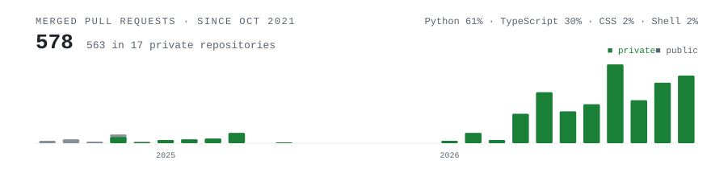
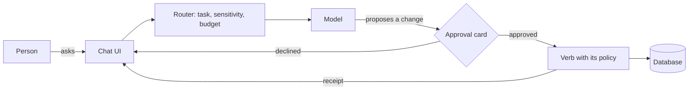

<picture>
  <source media="(max-width: 600px) and (prefers-color-scheme: dark)" srcset="assets/hero-dark-narrow.svg">
  <source media="(max-width: 600px)" srcset="assets/hero-light-narrow.svg">
  <source media="(prefers-color-scheme: dark)" srcset="assets/hero-dark.svg">
  
</picture>

Full-stack software engineer in Nairobi, building AI products end to end, with a particular eye for frontend and UI/UX. I design and ship the interface people touch and everything behind it: React and TypeScript design systems, Python services and data pipelines, and AI assistants that act with human approval.

**Frontend and UI/UX** · design systems and component frameworks, YAML-driven interfaces, accessible dashboards, dark and light theming, phone-first layouts. 
**AI** · agent tooling with approval flows, model routing and budgets, chat that renders live data views. 
**Full stack** · FastAPI and SQLAlchemy services, workflow engines, PostgreSQL, Docker, Playwright end-to-end tests.

<picture>
  <source media="(max-width: 600px) and (prefers-color-scheme: dark)" srcset="assets/activity-dark-narrow.svg">
  <source media="(max-width: 600px)" srcset="assets/activity-light-narrow.svg">
  <source media="(prefers-color-scheme: dark)" srcset="assets/activity-dark.svg">
  
</picture>

<picture>
  <source media="(max-width: 600px) and (prefers-color-scheme: dark)" srcset="assets/private-dark-narrow.svg">
  <source media="(max-width: 600px)" srcset="assets/private-light-narrow.svg">
  <source media="(prefers-color-scheme: dark)" srcset="assets/private-dark.svg">
  
</picture>

<b>How an AI change reaches the data</b>

<!-- open-source:start -->
MERGED PULL REQUESTS IN PUBLIC REPOSITORIES <a href="https://github.com/openmrs/openmrs-esm-stock-management-app">openmrs-esm-stock-management-app</a> 11 · <a href="https://github.com/openmrs-archive/openmrs-esm-clinical-views-builder">openmrs-esm-clinical-views-builder</a> 2 · <a href="https://github.com/openmrs/openmrs-esm-form-engine-lib">openmrs-esm-form-engine-lib</a> 1 · <a href="https://github.com/UCSF-IGHS/openmrs-esm-ohri">openmrs-esm-ohri</a> 1
<!-- open-source:end -->

Before this I worked on health software: OpenMRS 3 microfrontends and DUFT, a data analysis tool for health programmes.

[Portfolio](http://portfolio-psi-liart-96.vercel.app/) · [LinkedIn](https://www.linkedin.com/in/trevor-omondi-142561262/) · trvromondi@gmail.com
